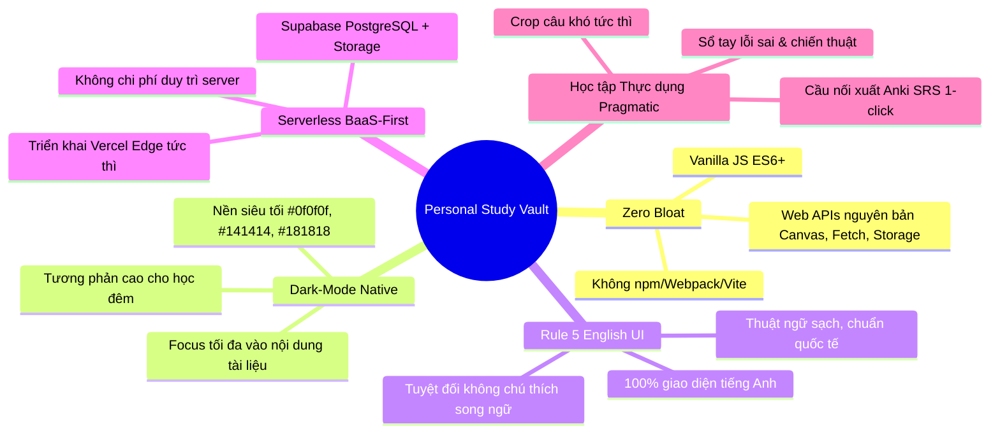
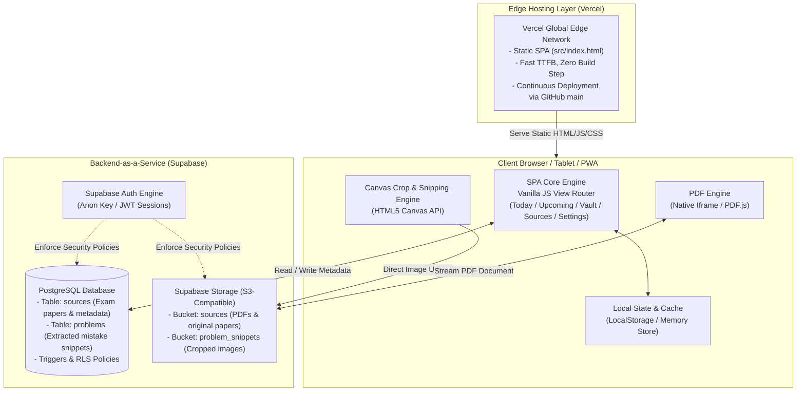
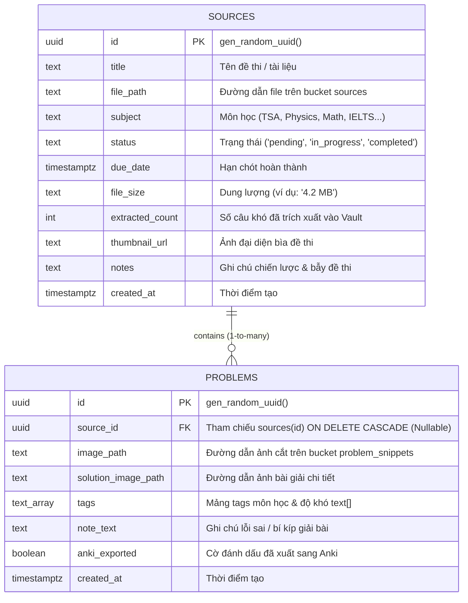

# HƯỚNG DẪN DỰ ÁN DÀNH CHO AGENTS (agents.md)
## Dự án: Personal Study Vault (Manage)

> **Tài liệu tham chiếu chuẩn dành cho AI Agents, Subagents và Kỹ sư Phần mềm**  
> Bản cập nhật: Tháng 11/2026 | Phiên bản kiến trúc: v2.0 (Serverless BaaS & PWA)

---

## 1. TỔNG QUAN DỰ ÁN (PROJECT OVERVIEW)

### 1.1. Sứ mệnh & Tầm nhìn
**Personal Study Vault (Manage)** là ứng dụng web PWA (Progressive Web App) cá nhân hóa, phục vụ mục tiêu học tập và ôn thi chuyên sâu. Ứng dụng giải quyết triệt để 3 nỗi đau lớn nhất của người học:
1. **Phân mảnh tài liệu**: Đề thi, bài tập, lời giải viết tay và file PDF nằm rải rác trên nhiều nền tảng, khó tra cứu.
2. **Thất thoát câu hỏi khó / lỗi sai**: Các câu làm sai hoặc câu vận dụng cao thường bị trôi sau khi làm xong đề, không được gom vào một kho tập trung để ôn lại.
3. **Thiếu cơ chế lặp lại ngắt quãng (Spaced Repetition)**: Không có cầu nối trực tiếp để chuyển đổi các lỗi sai từ đề thi thực tế thành thẻ ghi nhớ (Flashcards) phục vụ ôn luyện dài hạn.

### 1.2. Mục tiêu kỹ thuật cốt lõi
- **Tốc độ phản hồi tức thì (Instant TTFB & Zero Latency)**: Không phụ thuộc backend tự dựng, chạy trực tiếp trên Vercel Global Edge CDN kết hợp Supabase BaaS.
- **Tối giản & Độc lập (Zero Bloat)**: 100% Vanilla JavaScript ES6+, HTML5 ngữ nghĩa, Tailwind CSS CDN. Không sử dụng npm build step cồng kềnh.
- **Bảo mật & Quyền riêng tư (Data Ownership)**: Dữ liệu và file nhị phân lưu trữ hoàn toàn trên tài khoản Supabase (PostgreSQL + S3-compatible Storage) của người dùng thông qua cơ chế Row Level Security (RLS).

---

## 2. TRIẾT LÝ THIẾT KẾ CỐT LÕI (CORE DESIGN PHILOSOPHIES)



### 2.1. Tinh thần Vanilla & Zero Bloat (Rule 2)
- **Không framework trung gian**: Không sử dụng React, Vue, Angular hay Svelte. Toàn bộ logic giao diện được điều khiển qua DOM API và ES Modules.
- **Khai thác tối đa Web APIs**:
  - `HTML5 Canvas API`: Cắt (crop) câu hỏi từ đề thi gốc và trích xuất ảnh giải thích.
  - `Clipboard API`: Dán trực tiếp ảnh từ bộ nhớ đệm (`Cmd+V` / `Ctrl+V`).
  - `LocalStorage API`: Cache tức thì các ghi chú (Auto-save) và trạng thái giao diện.
  - `Fullscreen API`: Mở rộng tài liệu toàn màn hình khi làm bài.

### 2.2. Giao diện Dark-Mode Native & Sleek Ergonomics
- Hệ màu chủ đạo:
  - Nền tổng thể: `#0f0f0f` đến `#141414` (Oled/Deep Dark).
  - Nền card/panel: `#181818` đến `#1c1c1c`.
  - Viền phân tách: `#262626` đến `#2f2f2f`.
  - Điểm nhấn trạng thái: Đỏ cam san hô (`#e0564c` - Nút hành động chính / Deadline), Xanh ngọc (`#10b981` / Emerald - Hoàn thành / Auto-saved), Hổ phách (`#f59e0b` / Amber - Đang xử lý / Overdue).
- Bố cục thoáng đãng, loại bỏ triệt để các hiệu ứng trang trí thừa gây phân tâm khi học tập cường độ cao.

### 2.3. Quy tắc Rule 5: 100% English UI - Tuyệt đối không song ngữ thừa thãi
- Mọi chuỗi ký tự hiển thị trên giao diện người dùng (nút bấm, nhãn trường, placeholder, tiêu đề modal, thông báo trạng thái) **bắt buộc phải sử dụng 100% tiếng Anh chuẩn mực**.
- **Nghiêm cấm** việc chèn chú thích tiếng Việt trong ngoặc đơn (ví dụ: cấm `Save (Lưu)`, `Pending (Đang chờ)`).

---

## 3. KIẾN TRÚC HỆ THỐNG (SYSTEM ARCHITECTURE)



### 3.1. Các tầng thành phần
1. **Hosting Layer (Vercel)**: Dự án gồm frontend tĩnh (`src/index.html`, `src/js/supabase-config.js`). Mỗi commit trên nhánh `main` được triển khai tự động qua Vercel Edge Network trong vòng dưới 10 giây mà không cần bước `npm run build`.
2. **Client Layer (Vanilla SPA)**: Quản lý chuyển đổi giữa 5 View chính (`Today`, `Upcoming`, `Vault`, `Sources`, `Settings`) thông qua hàm `switchTab(tabId)`.
3. **BaaS Layer (Supabase)**:
   - Cơ sở dữ liệu quan hệ PostgreSQL với các khóa ngoại, indexes và trigger cập nhật số lượng trích xuất tự động.
   - Kho lưu trữ file nhị phân (Storage Buckets) phân loại riêng biệt cho đề thi gốc và ảnh trích xuất câu hỏi.

---

## 4. CHI TIẾT CÁC PHÂN HỆ TÍNH NĂNG (FEATURE BREAKDOWN)

### 4.1. Phân hệ Sources (Quản lý Đề thi & Tài liệu học tập)

Màn hình quản lý toàn bộ đề thi, tài liệu PDF và đề kiểm tra đã tải lên.

```text
+-----------------------------------------------------------------------------------+
| Sources                                                          [+ Upload Source] |
| 7 documents · 5 pending · 2 completed                                             |
|                                                                                   |
| [ 🔍 Search documents, subjects...                                         Cmd+K ] |
+-----------------------------------------------------------------------------------+
|  +-------------------+  +-------------------+  +-------------------+              |
|  | (P => Q) ^ ~Q=>~P |  |       /\_/\       |  |   S f(x)dx = lim  |              |
|  |     [✓ Done]      |  |   [⏳ Pending]    |  |   [⏳ Pending]    |              |
|  |-------------------|  |-------------------|  |-------------------|              |
|  | TSA Thinking ...  |  | Physics: Spring.. |  | Calculus: Integr..|              |
|  +-------------------+  +-------------------+  +-------------------+              |
|  +-------------------+  +-------------------+                                     |
|  | // Dijkstra Rust  |  | TASK RESPONSE 9.0 |                                     |
|  |     [✓ Done]      |  |   [⏳ Pending]    |                                     |
|  |-------------------|  |-------------------|                                     |
|  | Algorithms: PQ .. |  | IELTS Writing ..  |                                     |
|  +-------------------+  +-------------------+                                     |
+-----------------------------------------------------------------------------------+
```

- **Header thống kê thời gian thực**: Tự động tính toán phụ đề `X documents · Y pending · Z completed`.
- **Thanh tìm kiếm (Search Bar) với phím tắt `Cmd+K`**:
  - Hỗ trợ lọc tức thì theo tiêu đề tài liệu (`title`), môn học (`subject`) hoặc chủ đề (`topic`).
  - Lắng nghe sự kiện bàn phím `Cmd+K` (macOS) hoặc `Ctrl+K` (Windows/Linux) để tự động kích hoạt và focus vào ô tìm kiếm.
- **Lưới hiển thị 3 cột (3-Column Responsive Grid)**:
  - Trên màn hình lớn: Chia thành 3 cột cân xứng (`grid-cols-1 md:grid-cols-2 lg:grid-cols-3`).
  - **Khu vực Preview phía trên (`h-52`)**:
    - Status Badge nổi tròn góc trên bên phải: Vòng tròn xanh ngọc kèm checkmark (`✓`) cho trạng thái `completed`; Vòng tròn hổ phách kèm đồng hồ (`⏳`) cho trạng thái `pending`.
    - Render thumbnail từ ảnh thật, canvas trang đầu của PDF (qua `pdf.js`), hoặc Fallback mô phỏng học thuật (Công thức logic mệnh đề TSA, Biểu đồ lò xo dao động SVG, Tích phân giải tích KaTeX style, Code thuật toán Dijkstra bằng Rust, Cấu trúc bài luận IELTS).
  - **Thanh tiêu đề phía dưới**: Tên tài liệu sắc nét, tự động ẩn hiện nút xóa khi hover (`deleteSource(id)`).

### 4.2. Source Workspace Modal (Không gian Làm bài & Ghi chú Tràn viền)

Khi bấm vào bất kỳ thẻ đề thi nào, hệ thống sẽ mở ra **Source Workspace** toàn màn hình:

```text
+-------------------------------------------------------+---------------------------+
|                                                       | STATUS & DOCUMENT INFO  ✕ |
|                                                       | +-----------------------+ |
|                                                       | | Title           [✓Done]| |
|                                                       | | 📅 Deadline: 16 Nov... | |
|                                                       | | Subject: TSA          | |
|                                                       | | Topic: Vibe Coding    | |
|                  PDF VIEWER PANEL                     | +-----------------------+ |
|                                                       |                           |
|        (Tràn viền 100% chiều cao từ top: 0,           | PERSONAL NOTES & TRAPS    |
|         hiển thị trực tiếp tài liệu đề thi gốc)       |               [AUTO-SAVED]|
|                                                       | +-----------------------+ |
|                                                       | | Ghi chú chiến thuật,  | |
|                                                       | | bẫy đề thi, lỗi sai   | |
|                                                       | | thường gặp...         | |
|                                                       | +-----------------------+ |
|                                                       | Formulas & md       [Save]|
+-------------------------------------------------------+---------------------------+
```

- **Thiết kế Frameless (Không Navbar trên)**: Trình đọc PDF bên trái chiếm ~68-70% chiều ngang, bắt đầu trực tiếp từ tọa độ `top: 0` của màn hình, cho phép sử dụng thanh công cụ chuẩn (zoom, chuyển trang, in ấn) của PDF Viewer mà không bị che khuất.
- **Thanh kéo chỉnh kích thước (Draggable Splitter)**: Cho phép người dùng kéo chuột để thay đổi tỷ lệ hiển thị giữa vùng đọc PDF và vùng ghi chú từ 25% đến 80%.
- **Sidebar thông tin bên phải (~30-32%)**:
  - **Nút đóng `✕` & Phím `Escape`**: Đóng không gian làm việc tức thì, giải phóng scroll màn hình chính.
  - **Hộp `STATUS & DOCUMENT INFO`**:
    - Hàng 1: Tiêu đề đề thi + Nút chuyển trạng thái (`✓ Done` / `⏳ Pending`). Khi bấm, trạng thái được cập nhật lập tức trên UI và đồng bộ xuống Supabase `sources.status`.
    - Hàng 2: Icon lịch kèm ngày hạn chót `Deadline: <dd Mon yyyy>`.
    - Hàng 3: Hai cột hiển thị `Subject` (Môn học) và `Topic` (Chuyên đề).
  - **Khối `PERSONAL NOTES & TRAPS`**:
    - Nhãn trạng thái `AUTO-SAVED` màu xanh ngọc.
    - Textarea ghi chú lớn, tự động lưu sau 800ms ngừng gõ (Debounced auto-save) hoặc lưu thủ công qua nút đỏ `Save Notes`.
    - Lưu trữ đồng thời vào `localStorage` (offline safety) và cột `sources.notes` trên PostgreSQL.

---

### 4.3. Phân hệ Problem Vault (Kho Câu hỏi Khó & Sổ tay Lỗi sai)

Kho lưu trữ chuyên biệt các câu hỏi khó, bẫy trắc nghiệm hoặc bài giải mẫu trích xuất từ đề thi:
- **Tạo câu hỏi độc lập (Add External Problem)**:
  - Cho phép người dùng lưu nhanh các câu hỏi trắc nghiệm hoặc bài tập lượm lặt ngoài web, ảnh chụp bài giảng mà không bắt buộc phải có file đề thi gốc (`source_id = NULL`).
  - Hỗ trợ gán Tag (`#Mathematics`, `#Physics`, `#Advanced`, v.v.) và ghi chú phương pháp giải.
- **Bộ lọc & Tìm kiếm**:
  - Thanh tìm kiếm theo nội dung ghi chú (`note_text`), tag và tên đề thi gốc.
  - Hàng Tag Pills lọc nhanh theo từng môn học.
- **Problem Detail Modal (Xem & Đối chiếu Bài giải)**:
  - Hiển thị ảnh câu hỏi với khả năng phóng to toàn màn hình (`Image Zoom Modal`).
  - **Split-View Resizable giữa Đề & Giải**: Chia đôi khung nhìn để vừa đọc câu hỏi vừa phân tích ảnh lời giải chi tiết.
  - **Phân trang Next / Previous**: Duyệt nhanh qua các câu hỏi liên tiếp bằng phím mũi tên hoặc nút điều hướng mà không cần thoát modal.
  - Hỗ trợ gắn/gỡ ảnh lời giải (`solution_image_path`) và dán trực tiếp từ clipboard.

---

### 4.4. Công cụ Cắt ảnh Màn hình Tích hợp (In-App Canvas Snipping Tool)

Hệ thống chụp và crop ảnh câu hỏi trực tiếp trên trình duyệt bằng Vanilla Canvas API:
1. Người dùng kích hoạt công cụ cắt (Scissors Icon hoặc nút Crop Snippet).
2. Lớp phủ mờ `snippingToolOverlay` kích hoạt con trỏ dạng chữ thập (`cursor-crosshair`).
3. Thao tác kéo rê chuột (`mousedown` -> `mousemove` -> `mouseup`) xác định tọa độ vùng chữ nhật cần cắt.
4. Canvas API trích xuất ảnh vùng chọn thành đối tượng `Blob` định dạng PNG.
5. Tự động đính kèm vào modal lưu câu hỏi, tải thẳng lên Supabase Storage bucket `problem_snippets` và tạo bản ghi trong bảng `problems`.

---

### 4.5. Phân hệ Today & Upcoming (Kế hoạch & Lịch ôn tập)

- **View Today**:
  - Quản lý danh sách các đề thi và nhiệm vụ cần hoàn thành trong ngày.
  - Khu vực cảnh báo **Overdue** (Nhiệm vụ quá hạn) với nút **Reschedule all** để dời hạn thông minh.
  - Checkbox hoàn thành đề thi trực quan, tự động gạch ngang và đổi trạng thái sang `completed`.
- **View Upcoming**:
  - Dải chọn ngày tương tác (Interactive Day Strip) trong 14 ngày tới.
  - Phân nhóm nhiệm vụ theo các mốc: *Overdue*, *Today*, *Tomorrow*, và *Future dates*.

---

### 4.6. Xuất thẻ ghi nhớ Anki (Spaced Repetition Integration)

Tính năng xuất kho câu hỏi khó thành file thẻ Anki chuẩn:
- Thuật toán chuyển đổi toàn bộ câu hỏi trong bảng `problems` thành định dạng file TSV (Tab-Separated Values).
- Cấu trúc trường thẻ:
  - **Mặt trước (Front)**: Tên đề thi gốc + Thẻ `` chứa ảnh câu hỏi đã cắt.
  - **Mặt sau (Back)**: Ghi chú mẹo làm bài, bẫy đề thi và phương pháp giải (`note_text`).
  - **Nhãn (Tags)**: Môn học và các chuyên đề liên quan.
- Tải về file `.tsv` với 1 cú click (`Download .tsv Deck`), sẵn sàng nhập trực tiếp vào Anki Desktop hoặc AnkiMobile mà không cần cài đặt plugin bên ngoài.

---

### 4.7. Phân hệ Settings & Đồng bộ Dữ liệu

- Thống kê tình trạng kết nối tới Supabase BaaS (số lượng bản ghi `sources`, `problems`).
- Hiển thị hồ sơ người dùng đang đăng nhập qua Supabase Auth.
- **Nút Bơm Dữ liệu Mẫu (Seed Sample Study Data)**:
  - Tự động nạp 6 tài liệu mẫu chuẩn học thuật tương ứng với giao diện thiết kế:
    1. *TSA Thinking Skills: Deductive Logic & Valid Inferences* (Status: Completed)
    2. *Physics: Vertical Spring Pendulum & Restoring Force* (Status: Pending)
    3. *Calculus: Definite Integrals & Riemann Sums* (Status: Pending)
    4. *Algorithms: Dijkstra with Priority Queue & Negative Cycles* (Status: Completed)
    5. *IELTS Writing Task 2: Counter-Argument Structures* (Status: Pending)
    6. *[Reading v2] Vibe Coding Using Claude Code* (Status: Completed)

---

## 5. MÔ HÌNH DỮ LIỆU & DATABASE SCHEMA

Dự án sử dụng cơ sở dữ liệu PostgreSQL quản lý trên Supabase (`docs/SUPABASE_SCHEMA.sql`):



### 5.1. Trigger tự động cập nhật `extracted_count`
Hệ thống sử dụng Trigger PostgreSQL `trg_update_extracted_count` kích hoạt sau khi `INSERT` hoặc `DELETE` trên bảng `problems` để tự động cộng/trừ cột `sources.extracted_count`.

### 5.2. Chính sách bảo mật Row Level Security (RLS)
Cả hai bảng `sources` và `problems` đều được bật RLS. Quyền đọc/ghi/sửa/xóa được cấp phát thông qua anon key và authenticated role, đảm bảo người dùng có toàn quyền thao tác trên dữ liệu học tập cá nhân.

---

## 6. QUY TẮC PHÁT TRIỂN DÀNH CHO AI AGENTS (DEVELOPER RULES)

Khi bất kỳ AI Agent hoặc lập trình viên nào tiếp nhận dự án, **BẮT BUỘC** phải tuân thủ nghiêm ngặt 5 nguyên tắc vàng:

| Nguyên tắc | Tên gọi | Nội dung bắt buộc |
| :--- | :--- | :--- |
| **Rule 1** | **Context First** | Đọc lại `docs/PRD.md`, `docs/ARCHITECTURE.md` và `agents.md` trước khi sửa đổi bất kỳ đoạn code nào. |
| **Rule 2** | **Zero Bloat** | Giữ vững tinh thần Vanilla JS ES6+. **Không** tự ý cài thêm npm packages hay thư viện CDN bên thứ ba nếu chưa có sự phê duyệt rõ ràng từ người dùng. |
| **Rule 3** | **Schema Verification** | Mọi thay đổi về cấu trúc bảng hoặc thêm cột vào database phải được trình bày, xin xác nhận trước khi đưa vào code và cập nhật đồng bộ vào `docs/SUPABASE_SCHEMA.sql`. |
| **Rule 4** | **Atomic Git Commits** | Thực hiện `git add` và `git commit` chuẩn mực theo Conventional Commits (`feat(...)`, `fix(...)`, `docs(...)`, `style(...)`) sau mỗi khối tính năng hoàn tất. |
| **Rule 5** | **Strict English UI** | 100% văn bản hiển thị trên giao diện người dùng phải là tiếng Anh. Tuyệt đối không thêm chú thích song ngữ thừa thãi. |

### Quy trình Kiểm tra Chất lượng (Pre-commit Checklist):
1. **Kiểm tra cú pháp JavaScript**: Chạy `node` để parse toàn bộ khối mã inline trong `src/index.html` nhằm bảo đảm không có lỗi cú pháp.
2. **Kiểm tra tính cân bằng thẻ HTML**: Đảm bảo toàn bộ các thẻ `<div...>`, `<section...>`, `<aside...>` được đóng đầy đủ (diff = 0).
3. **Quét kiểm tra Rule 5**: Dùng regex kiểm tra ký tự tiếng Việt trên toàn bộ file giao diện để đảm bảo đạt 0 vi phạm song ngữ.
4. **Push lên remote repository**: Đẩy lên `origin main` để Vercel tự động deploy ra bản live.

---

## 7. CẤU TRÚC THƯ MỤC NGUỒN (PROJECT DIRECTORY TREE)

```text
/Users/qwerty/Projects/Manage/
├── docs/                           # Tài liệu kỹ thuật dự án
│   ├── AI_INSTRUCTIONS.md         # Quy tắc định hướng cốt lõi cho AI
│   ├── ARCHITECTURE.md            # Thiết kế kiến trúc hệ thống
│   ├── PRD.md                     # Tài liệu yêu cầu sản phẩm
│   └── SUPABASE_SCHEMA.sql        # Kịch bản khởi tạo database PostgreSQL & RLS
├── src/                            # Mã nguồn ứng dụng
│   ├── assets/                    # Tài nguyên tĩnh (ảnh, icons)
│   ├── css/                       # Tệp định dạng CSS bổ sung
│   ├── js/                        # Các module JavaScript phụ trợ
│   │   ├── scheduler.js           # Logic tính toán lịch học & deadline
│   │   └── supabase-config.js     # Khởi tạo Supabase client & biến môi trường
│   └── index.html                 # Ứng dụng Single Page Application hoàn chỉnh
├── .gitignore                     # Bỏ qua git (node_modules, local keys)
├── agents.md                      # Tài liệu tổng quan dự án dành cho AI Agents (file này)
├── README.md                      # Giới thiệu nhanh dự án
└── vercel.json                    # Cấu hình routing & headers cho Vercel Edge
```

---

## 8. HƯỚNG PHÁT TRIỂN TƯƠNG LAI (FUTURE ROADMAP)

1. **AI OCR & Auto-Tagging**: Tích hợp mô hình Gemini 2.0 Flash qua client-side SDK để tự động đọc câu hỏi từ ảnh crop, nhận diện công thức LaTeX và tự động gắn nhãn môn học.
2. **Offline-first Sync Engine**: Mở rộng từ `localStorage` sang `IndexedDB` kết hợp Service Worker để hỗ trợ học tập hoàn toàn ngoại tuyến khi mất kết nối mạng, tự động đồng bộ lên Supabase khi có mạng trở lại.
3. **Exam Generator Engine**: Cho phép chọn môn học, số lượng câu từ Problem Vault để tự động xuất ra một file PDF đề thi tổng hợp phục vụ thi thử.
