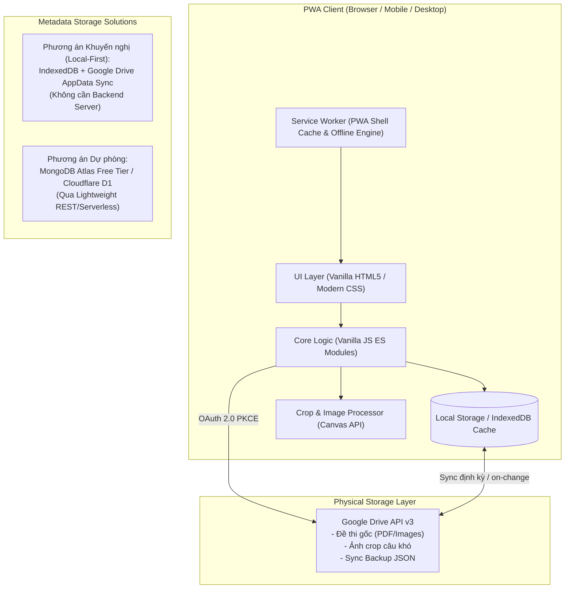

# Kiến trúc Hệ thống (ARCHITECTURE.md)
## Dự án: Personal Study Vault

---

### 1. Nguyên lý Thiết kế Kiến trúc (Architectural Principles)
1. **Decoupled Storage & Database**: Tách biệt hoàn toàn việc lưu trữ tệp vật lý nặng (ảnh, PDF) khỏi việc lưu trữ siêu dữ liệu (metadata, quan hệ tag, trạng thái deadline).
2. **Local-First & Offline-Capable**: Ứng dụng PWA hoạt động trơn tru ngay cả khi mất mạng; dữ liệu được phản hồi tức thì trên client trước khi đồng bộ.
3. **Zero Maintenance / Minimal Infrastructure**: Tránh phụ thuộc vào các dịch vụ máy chủ tốn kém hoặc quản trị phức tạp.

---

### 2. Mô hình Kiến trúc Tổng thể



---

### 3. Phân tầng Thành phần (System Components)

#### 3.1. Lưu trữ File Vật lý (Physical Storage)
* **Dịch vụ**: **Google Drive API (v3)**.
* **Cơ chế xác thực**: Google Identity Services (OAuth 2.0 PKCE flow - Client-side only), người dùng đăng nhập bằng tài khoản Google cá nhân.
* **Cấu trúc lưu trữ trên Drive**:
  ```text
  Personal Study Vault (Thư mục gốc)
  ├── /exams/           # File đề thi PDF, tài liệu gốc
  ├── /vault_snippets/  # Ảnh crop các câu hỏi khó
  └── vault_db.json     # File đồng bộ metadata dự phòng
  ```

#### 3.2. Cơ sở Dữ liệu & Quản lý Metadata (Database Proposal)
> [!NOTE]
> **Đề xuất của Senior Tech Lead**:
> Thay vì dựng một cụm MongoDB server độc lập (phải quản lý connection string, backend proxy để tránh lộ secret, chi phí server), chúng ta áp dụng kiến trúc **Local-First Database với IndexedDB + Cloud Sync trực tiếp vào Google Drive**:
>
> 1. **IndexedDB (Trình duyệt)**: Đóng vai trò Primary Database trên thiết bị người dùng.
>    - Ưu điểm: Tốc độ truy vấn siêu tốc (0ms network latency), native 100% trong trình duyệt, offline hoàn toàn, không tốn bất kỳ chi phí duy trì nào.
> 2. **Google Drive Sync (`vault_db.json`)**:
>    - Toàn bộ metadata được tự động mã hóa/đồng bộ 1 bản JSON lên thư mục riêng tư của app trên Drive mỗi khi có thay đổi.
>    - Khi mở ứng dụng trên thiết bị mới, PWA tự tải file này về và nạp vào IndexedDB.
> 3. *Nếu cần hệ thống nhiều người dùng hoặc database tập trung*: Sẽ sử dụng **MongoDB Atlas qua App Services Data API** hoặc **Cloudflare D1 / Supabase**.

* **Cấu trúc Schema Metadata (Dự kiến)**:
  - **Exams**: `id`, `drive_file_id`, `title`, `subject`, `deadline`, `status` (`pending`, `in_progress`, `completed`), `created_at`.
  - **Snippets (Vault)**: `id`, `exam_id`, `drive_image_id`, `tags` (`array`), `difficulty` (`easy`, `medium`, `hard`), `notes`, `created_at`, `review_count`, `last_reviewed_at`.
  - **Tags**: `id`, `name`, `color`.

#### 3.3. Nền tảng PWA (Progressive Web App)
* **Web App Manifest (`manifest.json`)**: Định nghĩa icon, theme_color, standalone display mode để cài đặt trực tiếp trên iOS, Android, macOS và Windows.
* **Service Worker (`sw.js`)**:
  - Chiến lược Cache: *Stale-While-Revalidate* cho app shell (HTML, CSS, JS icons).
  - Khả năng mở ứng dụng và ôn tập các câu trong Vault ngay cả khi không có mạng.
* **Responsive Layout**: Thiết kế Mobile-first bằng CSS thuần hiện đại (Grid, Flexbox, Container Queries).

#### 3.4. Module Xuất dữ liệu (Anki Export & Test Generator)
* **Test Generator**: Thuật toán bốc ngẫu nhiên câu hỏi theo tag trực tiếp trên Client.
* **Anki Exporter**:
  - Tạo bảng mapping câu hỏi (Front: Hình ảnh crop, Back: Ghi chú, giải pháp, đáp án).
  - Xuất ra file định dạng CSV/TSV chuẩn cho Anki kèm danh sách link ảnh hoặc xuất trực tiếp file `.apkg` (khi cần).
