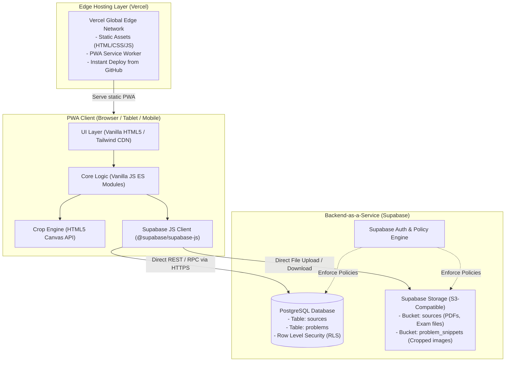

# Kiến trúc Hệ thống (ARCHITECTURE.md)
## Dự án: Personal Study Vault

---

### 1. Nguyên lý Thiết kế Kiến trúc (Architectural Principles)
1. **Serverless & BaaS-First**: Loại bỏ hoàn toàn nhu cầu dựng và duy trì máy chủ backend tự quản lý (Node.js/Express) để tập trung 100% vào trải nghiệm người dùng và logic nghiệp vụ.
2. **Unified Data & Physical Storage**: Thay vì dùng riêng Google Drive và cơ sở dữ liệu phân tán, dự án sử dụng **Supabase** làm nền tảng hợp nhất cho cả **Cơ sở dữ liệu quan hệ (PostgreSQL)** lẫn **Lưu trữ tệp nhị phân (Supabase Storage)**.
3. **Zero-Config Global Edge Deployment**: Frontend tĩnh được triển khai trên **Vercel**, tận dụng mạng phân phối toàn cầu (Global Edge CDN), HTTPS tự động và CI/CD tích hợp trực tiếp từ Git repo.
4. **Bảo mật tại tầng Dữ liệu (Row Level Security - RLS)**: Toàn bộ quyền truy cập đọc/ghi/sửa/xóa được kiểm soát nghiêm ngặt ngay tại tầng PostgreSQL thông qua các chính sách RLS.

---

### 2. Mô hình Kiến trúc Tổng thể

---

### 3. Phân tầng Thành phần (System Components)

#### 3.1. Nền tảng Lưu trữ & Cơ sở Dữ liệu (Supabase BaaS)
* **Cơ sở dữ liệu (PostgreSQL)**:
  - Sử dụng PostgreSQL phiên bản mới nhất do Supabase cung cấp.
  - Hỗ trợ kiểu dữ liệu mảng (`text[]`) cho trường `tags` giúp truy vấn gắn nhãn câu hỏi nhanh chóng và chính xác.
  - Thiết lập khóa ngoại (`FOREIGN KEY`) ràng buộc toàn vẹn giữa `problems.source_id` và `sources.id` với hành vi `ON DELETE CASCADE`.
  - Kích hoạt **Row Level Security (RLS)** trên toàn bộ các bảng.
* **Lưu trữ File Vật lý (Supabase Storage)**:
  - Thay thế Google Drive API bằng **Supabase Storage** để đơn giản hóa luồng tải lên và truy xuất:
    - **Bucket `sources`**: Chứa các file PDF đề thi gốc hoặc ảnh chụp bài làm.
    - **Bucket `problem_snippets`**: Chứa các file ảnh crop câu khó (PNG/JPEG) được sinh ra từ Canvas của trình duyệt.
  - Trực tiếp upload từ Client thông qua `supabase.storage.from('bucket').upload()`, nhận về public URL hoặc signed URL.

#### 3.2. Hosting & Triển khai (Vercel)
* **Cơ chế triển khai**: Kết nối trực tiếp GitHub Repository với Vercel. Mỗi commit mới trên nhánh `main` sẽ tự động trigger bản build và deploy lên Vercel trong vòng vài giây.
* **Không cần Build Step**: Vì dự án sử dụng Vanilla HTML/JS tĩnh và Tailwind CSS qua CDN, Vercel triển khai dạng *Static Site* tức thì, tối đa tốc độ TTFB (Time to First Byte).
* **Quản lý biến môi trường**: Thiết lập `SUPABASE_URL` và `SUPABASE_ANON_KEY` trong mục Environment Variables của Vercel Project.

#### 3.3. Tầng Giao diện Client (Vanilla PWA)
* **Single Page Application (SPA) Tối giản**: Cơ chế chuyển đổi View (`Today`, `Upcoming`, `Problem Vault`, `Sources`, `Settings`) điều khiển bằng Vanilla JavaScript thuần.
* **Canvas Crop Engine**: Người dùng chọn vùng câu hỏi cần trích xuất trực tiếp trên màn hình, Canvas API xuất ảnh dưới dạng `Blob`/`File` và gửi thẳng lên Supabase Storage.
* **Tích hợp Anki (SRS)**: Thuật toán xuất dữ liệu trích xuất từ bảng `problems` thành định dạng file TSV/CSV hoặc `.apkg` chuẩn để import vào Anki.
