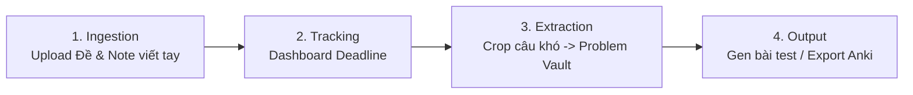

# Product Requirements Document (PRD)
## Dự án: Personal Study Vault

---

### 1. Tổng quan & Tầm nhìn
**Personal Study Vault** là một ứng dụng Web dạng PWA (Progressive Web App) cá nhân hóa, phục vụ mục đích học tập chuyên sâu, giải quyết vấn đề quản lý tài liệu đề thi, bài tập và đặc biệt là tối ưu hóa việc ôn luyện các câu hỏi khó/lỗi sai (Mistake/Hard Problem Vault).

* **Mục tiêu cốt lõi**:
  - Quản lý tập trung đề thi, tài liệu (PDF, hình ảnh bài giải/viết tay).
  - Tách lọc các câu hỏi khó vào một kho lưu trữ riêng biệt (Problem Vault).
  - Quản lý thời hạn ôn tập, deadline làm bài.
  - Tái tạo đề kiểm tra ngẫu nhiên từ kho câu hỏi khó hoặc đồng bộ sang Anki để ôn tập ngắt quãng (Spaced Repetition).
* **Triết lý thiết kế (Philosophy)**:
  - **Tối giản (Minimalist)**: Không rườm rà, loại bỏ triệt để các yếu tố đồ họa phân tâm.
  - **Thực dụng (Pragmatic)**: Tốc độ tải trang tức thì, thao tác trích xuất/crop ảnh nhanh gọn, dùng được mượt mà trên cả desktop và mobile (PWA).
  - **Không phụ thuộc cồng kềnh**: Giữ kiến trúc gọn nhẹ, ưu tiên chuẩn web gốc.

---

### 2. Các luồng nghiệp vụ chính (Core User Flows)

#### (1) Ingestion (Nạp tài liệu)
* Người dùng tải lên đề thi hoặc ảnh chụp bài làm/note viết tay (định dạng PDF, PNG, JPG).
* File vật lý được tải trực tiếp lên Google Drive cá nhân của người dùng nhằm tận dụng dung lượng miễn phí và độ tin cậy cao.
* Ứng dụng chỉ lưu trữ Metadata (File ID, tên file, ngày tải lên, môn học/chủ đề).

#### (2) Tracking (Theo dõi tiến độ & Deadline)
* Dashboard tổng quan hiển thị danh sách các đề thi/bài tập sắp tới hạn chót.
* Trạng thái trực quan: *Chưa làm*, *Đang làm*, *Đã hoàn thành*, *Cần ôn tập lại*.
* Tích hợp tính năng nhắc nhở trực quan theo độ ưu tiên thời gian (Due Soon / Overdue).

#### (3) Extraction (Trích xuất & Quản lý Problem Vault)
* Trực tiếp xem tài liệu/ảnh trên web và sử dụng công cụ crop ảnh tích hợp nhẹ nhàng (Canvas-based) để cắt phần câu hỏi khó/câu làm sai.
* Gán metadata cho câu hỏi trích xuất:
  - **Tags**: Môn học, chuyên đề, mức độ khó, dạng bài (ví dụ: `#Toan`, `#HinhKhongGian`, `#VanDungCao`).
  - **Ghi chú lỗi sai (Mistake Note)**: Tại sao làm sai hoặc chìa khóa giải quyết.
  - **Đường dẫn liên kết**: Trỏ ngược về file đề gốc trên Google Drive.

#### (4) Output (Tạo bài test & Tích hợp Anki)
* **Gen Test**:
  - Cho phép người dùng lọc theo Tag, chọn số lượng câu ngẫu nhiên từ Vault để sinh ra một bài kiểm tra ôn luyện nhanh.
  - Xuất ra định dạng in ấn hoặc làm trực tiếp trên giao diện tối giản.
* **Export Anki**:
  - Chuyển đổi các câu hỏi trong Vault thành định dạng gói thẻ Anki (`.apkg` hoặc định dạng text TSV/CSV chuẩn kèm media) để import vào Anki phục vụ Spaced Repetition (SRS).

---

### 3. Yêu cầu phi chức năng
* **Khả năng hoạt động ngoại tuyến (Offline capabilities)**: PWA cache giao diện và metadata cục bộ; có thể xem danh sách câu hỏi đã đồng bộ mà không cần kết nối mạng.
* **Bảo mật & Quyền riêng tư**: Dữ liệu đề thi nằm trên Google Drive cá nhân của người dùng; không đưa dữ liệu qua server trung gian không đáng tin cậy.
* **Hiệu năng**: Khởi động trang dưới 1 giây, thao tác crop mượt mà với tài nguyên trình duyệt gốc.
